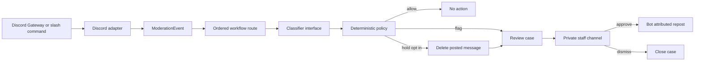

# Architecture and contracts

This is a small deployment unit with clean seams rather than an immediate microservice fleet. It uses normalized events, separate classification/policy/actions, review cases, and auditability. No source was copied from private predecessor projects. See the [public boundary](source-available-boundary.md).

The `/submit` path creates a review case without a public original. Only approval publishes it. The normal message path cannot intercept publication. Native Discord AutoMod owns any actual pre-send filter.

## Contract boundaries

| Boundary | Contract | Owner |
| --- | --- | --- |
| Discord input | `ModerationEvent` with surface, IDs, text, counts | Discord adapter |
| Route | `selectRoute(routes, trigger, channel, surface) → provider, mode` | Instance operator |
| Classifier | `Classifier.classify(event) → Classification` | Local/Jev/Laya/local System One provider |
| Decision | `decide(event, classification, mode) → PolicyResult` | Bot policy |
| Review | `ReviewCase` with route/provider/model, status, expiry, reviewer, optional text | Case store |
| Discord action | Staff alert, delete, or approved repost | Discord adapter |

The versioned [matrix](../schemas/moderation-matrix.v1.json) holds questions and thresholds; [its schema](../schemas/moderation-matrix.v1.schema.json), [route schema](../schemas/classifier-routes.v1.schema.json), and [event schema](../schemas/moderation-event.v1.schema.json) are available to other tools. The normalized event keeps Discord specifics at the edge. Provider implementations do not get bot tokens. Typed-decision adapters send redacted text, surface, and counts; they do not send Discord user IDs. Default `observe` never deletes or creates review cases. See [classifier integrations](classifier-integrations.md) and [permissions](permissions-and-acl.md).

## Current operating limits

- One process and one case directory. Case transitions are serialized in-process, not across replicas. Approval publication and case status update are two operations; a crash between them can leave a posted item with a pending case. Do not run two instances against one case directory.
- Cases are JSON files with 24-hour expiry. This is a pilot store, not a multi-tenant database or a complete audit ledger. File permissions are requested as owner-only where the platform supports them.
- The monitored-channel allowlist defaults to empty. Classification concurrency is capped at eight. When saturated, messages are skipped and a count-free warning is logged. The bot never deletes a message because its provider failed or capacity was exceeded.
- Attachments, embeds, images, and voice audio are not analyzed. An attachment-bearing message may be flagged from its text but is never automatically held.
- A bot repost is distinguishable from a member post. It suppresses mentions and link embeds. A human must review the actual content in the private staff channel before approval.

## Future standardized modules

Add a versioned JSON schema for events/decisions/cases, an authenticated service adapter, a proper transactional case store, native AutoMod rule sync with dry run, a labeled evaluation pack, moderator appeals, rate/backpressure metrics, and optional voice transcript ingestion. Keep the simple single-process path usable for community contributors.
